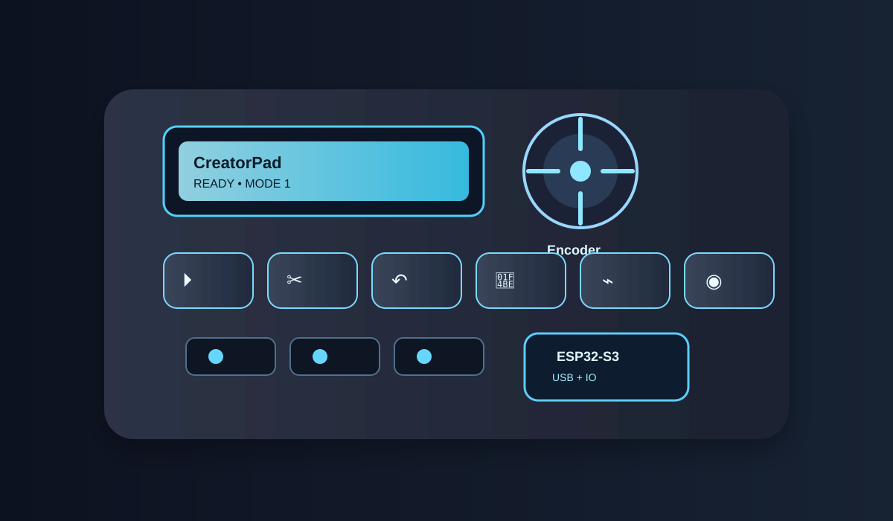

# CreatorPad

## Overview

CreatorPad is a custom hardware control pad designed to make video editing and everyday computer shortcuts easier to access.

## Planned Features

* Physical buttons for play/pause, cut, undo, and save
* Rotary encoder for additional controls
* OLED display for showing modes and status
* ESP32-S3 microcontroller
* USB connection to a computer
* Custom 3D-printed enclosure

## Current Progress

I am researching the required components, learning about the ESP32-S3, and planning the circuit connections. This is my first hardware project, so I am documenting the design process as I learn.

## Next Steps

* Finalize the component list
* Complete the circuit design
* Test the hardware
* Design the enclosure
